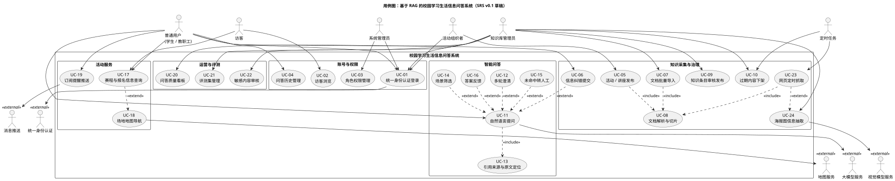

# 软件需求规格说明书（SRS）

> 项目：基于 RAG 的校园学习生活信息问答系统
> 课程：软件工程课程设计（户现锋班，CST3619）
> 版本：v0.1 草稿。日期：2026-11-26。状态：待第 11 周课堂评审。
> 基线：评审通过后发布 v1.0 Release，之后的改动走「需求变更申请」Issue + PR。

## 0. 文档信息

| 项 | 内容 |
| --- | --- |
| 编写 | TTAWDTT（AI 辅助起草，声明见附录） |
| 评审 | 第 11 周课堂评审，看三点：完整、一致、可测试 |
| 依据 | [README](../../README.md) 立项草案 v0.1、《软件工程课程设计要求（版本 2）》、第 1 到 8 讲课件 |
| 关联 | 选题 Issue #1，SRS 草稿 Issue #3，[追溯矩阵 v0](追溯矩阵-v0.md) |

## 1. 引言

### 1.1 目的

本文定义系统要做什么、做到什么程度、怎样算做到了。它是分析模型、设计规约和测试用例的依据。每条需求都有编号，能追溯到用例、设计和测试。

### 1.2 范围

本期做：

- 多源语料采集：公开网页定时抓取（UC-23）、海报图信息抽取（UC-24）、手动上传兜底（UC-07），加文档解析（PDF、Word、网页、公众号图文导出）
- 知识切片、向量化、元数据管理（来源、发布时间、有效期、所属场景）
- 检索、重排、生成、引用回溯的问答链路
- 多轮追问、场景筛选、未命中转人工、答案反馈与纠错
- 活动 / 讲座信息的发布、审核与订阅提醒
- 运营看板与检索质量评测

本期不做：

- 不做通用校园助手，不直连课表、成绩、一卡通等业务系统
- 不做活动在线报名与支付，只提供报名入口跳转
- 不自研大模型与向量数据库，用成熟组件集成
- 不做移动端原生 App，本期为响应式 Web

### 1.3 术语

| 术语 | 含义 |
| --- | --- |
| RAG | 检索增强生成。先检索校内语料，再让大模型基于检索结果作答 |
| 知识条目 | 一条可被检索和引用的最小知识单元，带来源、有效期、所属场景等元数据 |
| 切片 | 文档解析后切成的片段，是知识条目的来源 |
| 重排 | 对初步检索结果按相关性重新排序 |
| 引用 | 回答中每个事实陈述对应的来源条目及原文位置 |
| 拒答 | 问题中的事项均无有效证据支持时，明确说明无法确认并提供求助入口。已知的公告待核实状态按 UC-11 处理 |
| 增量 | 可独立演示的交付版本，v0.1 / v0.2 / v0.3 |

### 1.4 参考资料

- [README](../../README.md)：项目章程、过程模型选型、22 个用例规划、非功能需求初稿、风险登记册。SRS 在此基础上新增 UC-23、UC-24（Issue #6）
- 《软件工程课程设计要求（版本 2）》
- 《软件工程课程设计 课堂形式、内容与要求（户现锋班）》
- 第 1 到 8 讲课件，本检查点对应第 3 讲「SRS 定稿」

### 1.5 编号与优先级约定

| 项 | 约定 |
| --- | --- |
| 需求编号 | 功能需求 REQ-F01 到 F24，非功能需求 REQ-N01 到 N04 |
| 用例编号 | UC-01 到 UC-24，非功能用例 UNF-01 到 UNF-04，与需求一一对应 |
| 验收标准 | AC-用例号加字母序号，如 AC-11a |
| 优先级 | 用目标增量表示：v0.1 知识问答、v0.2 活动服务、v0.3 运营与质量。本文的增量归属是建议，评审时定 |
| 状态 | 「待访谈确认」表示尚无真人访谈或干系人确认，访谈后更新 |

## 2. 总体描述

### 2.1 产品定位

面向高校校园场景，把分散在通知公告、活动推文、讲座预告、场馆与后勤说明中的非结构化信息沉淀为可检索的知识库，为师生提供带原文出处、可追溯、可纠错的自然语言问答。

与通用大模型问答的区别：答得准，答案由校内语料支撑，无依据时拒答；答得新，过期内容自动降权或下架；答得到，回答附带来源链接与原文定位。

### 2.2 用户角色

| 角色 | 说明 | 目标 | 权限 |
| --- | --- | --- | --- |
| 访客 | 未登录的校内外人员 | 浏览公开活动信息 | 浏览公开问答与公开活动 |
| 普通用户（学生 / 教职工） | 经校园统一身份认证登录 | 快速得到可信答案 | 提问、追问、查看历史、订阅提醒、提交纠错与反馈 |
| 活动组织者（社团 / 学院 / 体育部） | 活动与讲座的责任方 | 让活动信息被准确检索到 | 发布、修改本人活动与讲座，查看咨询统计 |
| 知识库管理员（图书馆或信息中心） | 运营知识库 | 保证条目准确、及时 | 文档导入、切片审核、条目上下架、纠错处理、质量看板、评测集 |
| 系统管理员 | 运维方 | 系统可用、合规 | 角色与权限配置、审计日志、模型与索引参数 |

权限模型为 RBAC + 资源归属。角色决定功能菜单，资源归属决定数据可见范围，组织者只能改自己发布的活动。

### 2.3 运行环境

- 客户端：响应式 Web，支持主流桌面与手机浏览器。
- 服务端：API 服务、问答编排、PostgreSQL（pgvector）、对象存储，容器化部署。
- 外部服务：校园统一身份认证（OAuth2 / CAS）、地图服务、消息推送、大模型与 Embedding API。

### 2.4 约束

| 编号 | 约束 |
| --- | --- |
| C-1 | 技术栈：前端 Vue 3 + TypeScript，后端 FastAPI，PostgreSQL + pgvector，对象存储存原始文档 |
| C-2 | 不自研大模型与向量数据库，通过 API 调用。密钥存环境变量或 GitHub Secrets，严禁进入提示词、仓库和日志 |
| C-3 | 统一身份认证返回的学工号仅用于身份映射，不写入问答日志 |
| C-4 | 只采集无需登录的公开页面，抓取限速（请求间隔默认不低于 1 秒），不绕过访问控制。抓取内容仅限校内服务使用，不再对外分发，不进公网搜索引擎。图书馆电子资源与公众号图文需单独确认授权（Q-1） |
| C-5 | AI 产出的代码、用例、文档须注明工具与用途并经人工评审。架构决策、需求确认、合并放行三处由人签字 |
| C-6 | 全流程 GitHub 留痕。需求与变更建 Issue，main 禁止直推，每个 PR 至少 1 人评审 |

### 2.5 假设与依赖

| 编号 | 假设 / 依赖 | 不成立时的影响 |
| --- | --- | --- |
| A-1 | 校园公告、公众号图文、讲座通知等公开信息可以采集用于校内问答 | 语料不足，问答覆盖面下降，需改为人工录入 |
| A-2 | 活动信息由组织者自行录入（增量 2） | 若由管理员统一录入，UC-05 的角色与验收标准需调整（Q-3） |
| D-1 | 学校统一身份认证可提供测试环境 | 用模拟 OAuth2 服务替代，并在文档中声明（Q-2） |
| D-2 | 大模型与 Embedding 服务可通过 API 调用，额度满足课程需要 | 换用其他服务或本地小模型，时延与质量需重测（Q-4） |
| D-3 | 地图与消息推送服务有可用的免费额度或测试环境 | 增量 2 的 UC-18、UC-19 降级为文字与站内提醒 |

### 2.6 待确认事项

| 编号 | 事项 | 影响 | 需要谁决定 |
| --- | --- | --- | --- |
| Q-1 | 图书馆电子资源与公众号图文能否使用。公开公告与讲座信息已于 2026-11-26 实测确认可抓取 | C-4、UC-07、UC-23、UC-09 | 图书馆或信息中心 |
| Q-2 | 统一身份认证测试环境 | UC-01、D-1 | 信息中心 |
| Q-3 | 活动信息由谁运营录入 | UC-05、UC-10、A-2 | 指导教师、学生会或体育部 |
| Q-4 | 大模型与 Embedding 服务的选型、额度与数据出境合规 | UNF-01、UNF-02、D-2 | 架构 / 设计工程师、指导教师 |
| Q-5 | 答辩前的发布形式，部署地址与演示环境 | 交付演示 | 项目经理 |
| Q-6 | 管理员「纠错处理」是否单独立用例 UC-23 | UC-06、UC-09 | 需求分析师 |
| Q-7 | UNF-01「不含大模型排队」的计时口径 | UNF-01 | 测试 / 质量工程师 |

## 3. 功能需求

每个用例给出编号、参与者、目标增量、描述和验收标准。验收标准用 Given / When / Then 写。UC-05、UC-06、UC-11 三个用例另给基本流和备选流，作为课堂讲解用例。完整对应关系见追溯矩阵。

### 3.1 账号与权限

#### UC-01 统一身份认证登录（REQ-F01）

- 主参与者：普通用户、活动组织者、知识库管理员、系统管理员
- 次参与者：统一身份认证服务
- 增量：v0.1
- 描述：用户通过校园统一身份认证登录，系统按角色建立会话。
- 验收标准：
  - AC-01a：Given 用户未登录，When 点击「校园登录」并完成认证，Then 回调后建立会话，进入其角色对应的首页。
  - AC-01b：Given 认证服务返回失败或用户取消，When 回调，Then 显示失败原因，不创建会话，不写入任何个人信息日志。
  - AC-01c：Given 已登录用户，When 访问其角色无权限的页面或接口，Then 返回 403，不返回数据。

#### UC-02 访客浏览（REQ-F02）

- 主参与者：访客
- 增量：v0.1
- 描述：未登录用户可以浏览公开活动信息与公开问答。
- 验收标准：
  - AC-02a：Given 未登录，When 打开首页，Then 看到公开活动信息与公开问答列表，页面不出现「提问」「订阅」入口。
  - AC-02b：Given 未登录，When 直接访问需要登录的地址，Then 跳转登录页，登录后回到原地址。
  - AC-02c：公开列表只包含状态为「已发布」且可见性为「公开」的条目。

#### UC-03 角色权限管理（REQ-F03）

- 主参与者：系统管理员
- 增量：v0.3。角色与权限的基线配置随 v0.1 以种子数据提供，管理界面在 v0.3 交付。
- 描述：系统管理员为用户分配角色，所有变更留审计记录。
- 验收标准：
  - AC-03a：Given 管理员为用户分配角色，When 该用户下一次请求，Then 新角色立即生效，操作写入审计日志，含操作人、时间、对象与变更前后角色。
  - AC-03b：Given 非管理员，When 调用角色管理接口，Then 返回 403。
  - AC-03c：角色集合固定为 2.2 节的 5 类，本期不支持自定义角色，创建自定义角色的请求返回 400。

#### UC-04 问答历史管理（REQ-F04）

- 主参与者：普通用户
- 增量：v0.2
- 描述：用户查看、筛选和删除自己的问答会话。
- 验收标准：
  - AC-04a：Given 已登录用户，When 打开历史，Then 只看到自己的会话，按时间倒序，可按场景筛选。
  - AC-04b：Given 用户 A 持有用户 B 的会话 ID，When 请求该会话，Then 返回 404，不返回内容。
  - AC-04c：When 用户删除一条会话，Then 列表中不再显示，删除前有确认提示，审计日志保留操作记录。

### 3.2 知识采集与治理

#### UC-05 活动 / 讲座发布（REQ-F05）

- 主参与者：活动组织者
- 次参与者：知识库管理员（处理异常）
- 增量：v0.2
- 描述：组织者发布或修改本人负责的活动与讲座，信息进入知识库并可被问答检索。
- 前置条件：组织者已登录（UC-01）。
- 触发：组织者点击「发布活动 / 讲座」。
- 基本流：
  1. 组织者填写标题、时间、地点、来源链接、所属场景、有效期。
  2. 系统校验必填项，有效期不得早于开始时间。
  3. 组织者提交。
  4. 系统生成知识条目，状态「已发布」，写入元数据（发布人、来源、发布时间、有效期），触发切片与向量化（UC-08）。
  5. 系统显示「已发布」，条目可被问答检索。
- 备选流：
  - 3a. 必填项缺失或有效期无效：系统标出字段，不提交。
  - 3b. 组织者修改非本人发布的活动：返回 403。
  - 4a. 提交成功但向量化失败：状态显示「待处理」，管理员可见并重试。
- 后置条件：条目已入库、已索引，带有效期。
- 业务规则：有效期必填。到期自动降权，并按 UC-10 下架。
- 验收标准：
  - AC-05a：Given 组织者，When 提交完整信息，Then 条目状态「已发布」，下一次提问可检索到并带来源。
  - AC-05b：Given 组织者 A，When 请求修改组织者 B 的活动，Then 返回 403。
  - AC-05c：Given 有效期早于开始时间，When 提交，Then 拒绝并提示。

#### UC-06 信息纠错提交（REQ-F06）

- 主参与者：普通用户
- 次参与者：知识库管理员
- 增量：v0.2
- 描述：用户对某条回答提出纠错，生成纠错单，处理后用户可见结果。
- 前置条件：用户已登录，存在一条已返回的回答。
- 基本流：
  1. 用户在某条回答上点击「纠错」。
  2. 系统显示纠错表单，预填回答 ID、问题与引用条目。
  3. 用户选择纠错类型（信息过期、信息错误、引用错误、其他）并填写说明。
  4. 系统生成纠错单，状态「待处理」，关联回答与引用条目。
  5. 用户在「我的纠错」中看到状态。
- 备选流：
  - 1a. 未登录用户点击纠错：跳转登录，登录后回到原回答。
  - 3a. 说明为空：不提交，提示填写。
- 后置条件：纠错单已创建，管理员可在处理队列中看到。
- 验收标准：
  - AC-06a：Given 已登录用户，When 提交纠错，Then 生成纠错单，含回答 ID、引用条目 ID、类型与说明，状态「待处理」。
  - AC-06b：Given 未登录，When 点击纠错，Then 跳转登录，登录后回到原回答并保留纠错入口。
  - AC-06c：When 管理员处理后，Then 状态变为「已采纳」或「已驳回」，用户可见。
- 关联：Q-6，管理员的纠错处理是否单独立用例。

#### UC-07 文档批量导入（REQ-F07）

- 主参与者：知识库管理员
- 增量：v0.1
- 描述：手动上传兜底入口。公开网页由 UC-23 定时抓取，管理员只上传抓取覆盖不到的内容（公众号图文导出、PDF 文件）。每个文件生成一个导入任务。
- 验收标准：
  - AC-07a：Given 管理员，When 上传多个 PDF、Word、HTML 或 Markdown 文件，Then 每个文件生成一个导入任务，列表显示成功数与失败数。
  - AC-07b：Given 文件格式不支持，When 导入，Then 该任务失败并说明原因，其他文件不受影响。
  - AC-07c：Given 文件内容哈希与已有文档相同，When 导入，Then 提示重复，不生成新文档。

#### UC-08 文档解析与切片（REQ-F08）

- 主参与者：系统（导入或发布触发）
- 次参与者：知识库管理员（处理异常）
- 增量：v0.1
- 描述：解析文档并切成片段，每个片段保留来源与位置，可回溯原文。
- 验收标准：
  - AC-08a：Given 导入成功，When 解析完成，Then 每个切片保留来源文档、页码或段落位置、原文文本，可回溯到原文。
  - AC-08b：Given 扫描版 PDF 没有文本层，When 解析，Then 文档标记「需人工处理」，管理员可见。
  - AC-08c：Given 含表格的内容，When 切片，Then 表格切片保留表头行，可在引用预览中按表格显示。

#### UC-09 知识条目审核发布（REQ-F09）

- 主参与者：知识库管理员
- 增量：v0.1
- 描述：管理员抽检切片并发布知识条目，发布的条目进入向量索引。
- 验收标准：
  - AC-09a：Given 切片完成，When 管理员抽检并点击「发布」，Then 该版本状态为「已发布」，进入向量索引，可被检索。
  - AC-09b：Given 某版本状态不是「已发布」，When 用户提问，Then 该版本不出现在检索结果中。
  - AC-09c：每次审核记录审核人、时间与决定。
  - AC-09d：Given 同一原公告有已发布旧版和待审核新版，When 管理员审核通过并发布新版，Then 新版成为唯一可用于当前问答的版本，旧版退出当前问答的检索范围。

#### UC-10 过期内容下架（REQ-F10）

- 主参与者：定时任务
- 次参与者：知识库管理员（手动下架）
- 增量：v0.2
- 描述：到期条目自动下架并默认排除，管理员可手动下架，条目保留可查。
- 验收标准：
  - AC-10a：Given 条目有效期早于当前日期，When 每日定时任务运行，Then 状态改为「已过期」，默认检索排除。
  - AC-10b：Given 用户提问命中已过期条目，When 回答，Then 明确告知该信息已于某日过期，并给出来源。
  - AC-10c：Given 管理员手动下架条目，When 下架完成，Then 立即从检索排除，条目保留可查，不物理删除。

### 3.3 智能问答

#### UC-11 自然语言提问（REQ-F11）

- 主参与者：普通用户
- 次参与者：大模型服务
- 增量：v0.1
- 描述：用户用自然语言提问。系统回答有有效证据的事项并附来源，对其余事项明确说明暂未确认。各事项均无有效证据且无已知待核实状态时拒答。
- 前置条件：用户已登录。
- 基本流：
  1. 用户输入问题。
  2. 系统结合会话上下文改写查询（UC-12）。
  3. 若问题涉及新版待审核公告的讲座当前地点，按备选流 3a 处理该地点。其余事项按场景筛选（UC-14），在「已发布」且未过期的条目中做混合检索（向量 + 关键词）。
  4. 重排，取前 N 条。
  5. 逐项核对来源能否支持用户所问的事实。各事项均无有效证据且无已知待核实状态时，转备选流 5a。
  6. 回答有依据的事项，对其余事项说明暂未确认。有已知公告待核实状态时使用备选流 3a 的提示。
  7. 校验每个事实陈述的引用能否支持该陈述。校验失败时转备选流 7a。
  8. 返回回答与引用列表（UC-13）。
- 备选流：
  - 3a. 提示「公告有更新，地点待核实」并附原公告链接。旧版和待审核新版中的地点均不作为当前地点回答。同时问了其他事项时，继续查证并回答其中有依据的事项。
  - 5a. 返回拒答文案与求助入口（UC-15），不生成事实答案。
  - 7a. 尝试补齐或更正引用一次。仍缺少有效引用的事项标为暂未确认，保留有有效引用的事项。各事项均无有效证据且无已知待核实状态时，转备选流 5a。
  - 1a. 未登录：跳转登录。
- 后置条件：回答、引用与反馈入口已展示，问题与回答写入会话（UC-04）。
- 验收标准：
  - AC-11a：Given 已登录用户，When 所问事项均有有效证据，Then 逐项回答，每个事实陈述附可核对的原文引用，时延满足 UNF-01。
  - AC-11b：Given 所问事项均无有效证据且无已知待核实状态，When 用户提问，Then 返回拒答文案和求助入口，回答中不含无依据的事实陈述。
  - AC-11c：Given 访客，When 点击提问框，Then 跳转登录，登录后问题保留。
  - AC-11d：Given 系统已发现同一 URL 的讲座公告内容有变更，且新版待审核，When 用户询问当前地点，Then 提示「公告有更新，地点待核实」并附原公告链接。若旧版写地点 A、新版写地点 B，A 和 B 均不作为当前地点回答。若用户同时问时间且有有效来源确认时间，一并回答时间并附其来源。
  - AC-11e：Given 地点 B 的新版公告已审核通过并发布，When 用户询问该讲座的当前地点，Then 仅回答地点 B 并附原公告链接。即使之前的对话提到 A，也不把 A 当成当前地点。
  - AC-11f：Given 已发布的原公告确认讲座时间，但没有有效来源确认地点，也没有地点待审核的已知状态，When 用户问「几点、在哪」，Then 回答已确认的时间并附原公告链接，明确说明「地点暂未确认」。

#### UC-12 多轮澄清（REQ-F12）

- 主参与者：普通用户
- 增量：v0.1
- 描述：用户在同一会话中追问，系统结合上下文理解指代。
- 验收标准：
  - AC-12a：Given 上一轮回答某活动的时间，When 用户追问「那下周呢」，Then 系统结合上一轮上下文改写查询并回答。
  - AC-12b：When 用户点击「新对话」，Then 上下文清空，下一问不携带旧上下文。
  - AC-12c：Given 会话超过配置的轮数，When 追问，Then 只有最近配置轮数内的内容参与改写。

#### UC-13 引用来源与原文定位（REQ-F13）

- 主参与者：普通用户
- 增量：v0.1
- 描述：含有校内事实陈述的回答附引用列表，用户可跳转原文核对。
- 验收标准：
  - AC-13a：含有校内事实陈述的回答，其引用列表显示来源标题、发布单位、发布时间、有效期、原文片段（不超过 200 字）与跳转链接。
  - AC-13b：Given 用户点击引用，When 原文可访问，Then 打开原文并定位到切片对应页码或段落。
  - AC-13c：Given 引用条目已过期或下架，When 显示引用，Then 标注状态。

#### UC-14 场景筛选（REQ-F14）

- 主参与者：普通用户
- 增量：v0.1
- 描述：用户限定提问场景，检索只在对应条目中进行。
- 验收标准：
  - AC-14a：Given 用户选择场景（讲座、赛事、场馆、日常），When 提问，Then 只在该场景的条目中检索。
  - AC-14b：When 用户清除筛选，Then 恢复全库检索。
  - AC-14c：筛选状态在同一会话中保持，开始新对话时清除。

#### UC-15 未命中转人工（REQ-F15）

- 主参与者：普通用户
- 次参与者：知识库管理员或咨询人员
- 增量：v0.1
- 描述：拒答时给出求助入口与咨询渠道，用户可提交咨询工单。
- 验收标准：
  - AC-15a：Given 拒答，When 显示回答，Then 同时展示求助入口与对应咨询渠道，渠道来源为知识库中的「求助渠道」条目。
  - AC-15b：Given 用户提交咨询，When 提交成功，Then 生成工单，含问题与检索到的相近条目，管理员可见。
  - AC-15c：Given 工单已处理，When 用户查看历史，Then 看到处理回复。

#### UC-16 答案反馈（REQ-F16）

- 主参与者：普通用户
- 增量：v0.1
- 描述：用户对回答标记有用或无用，数据进入质量看板。
- 验收标准：
  - AC-16a：每条回答提供「有用 / 无用」，反馈记录回答 ID、问题 ID、用户标识与时间。
  - AC-16b：同一用户对同一回答只能提交一次反馈，可修改。
  - AC-16c：反馈数据进入 UC-20 看板统计。

### 3.4 活动服务

#### UC-17 赛程与报名信息查询（REQ-F17）

- 主参与者：普通用户、访客
- 增量：v0.2
- 描述：回答赛程、时间、地点与报名入口。
- 验收标准：
  - AC-17a：Given 用户问某场比赛的时间地点，When 命中赛程表，Then 回答给出场地与时间，附来源。
  - AC-17b：When 回答涉及报名，Then 附报名入口链接，跳转外部，不在本系统报名。
  - AC-17c：时间表类回答以表格返回，表头来自原切片。

#### UC-18 场地地图导航（REQ-F18）

- 主参与者：普通用户
- 次参与者：地图服务
- 增量：v0.2
- 描述：回答含地点时提供地图跳转。
- 验收标准：
  - AC-18a：Given 回答含地点且地点有坐标，When 用户点击「查看地图」，Then 跳转地图服务定位到该坐标。
  - AC-18b：Given 地点无坐标，When 显示回答，Then 不显示地图按钮。
  - AC-18c：Given 地图服务不可用，When 点击，Then 降级显示地址文字，不报错。

#### UC-19 订阅提醒推送（REQ-F19）

- 主参与者：普通用户
- 次参与者：消息推送服务
- 增量：v0.2
- 描述：用户订阅活动，活动更新或临近时收到推送。
- 验收标准：
  - AC-19a：Given 已登录用户订阅某活动，When 活动更新或临近（提前 1 天），Then 收到推送。
  - AC-19b：订阅入口在活动详情中，用户可随时取消。
  - AC-19c：推送失败重试 3 次并记录日志，不阻塞主流程。

### 3.5 运营与评测

#### UC-20 问答质量看板（REQ-F20）

- 主参与者：知识库管理员
- 增量：v0.3
- 描述：看板汇总问答质量指标。
- 验收标准：
  - AC-20a：看板展示问题量、拒答率、引用覆盖率、反馈有用率、无答案 Top 问题，按日与周。
  - AC-20b：可按场景筛选。
  - AC-20c：数据延迟不超过 1 天。

#### UC-21 评测集管理（REQ-F21）

- 主参与者：知识库管理员、开发工程师
- 增量：v0.3
- 描述：维护评测集并运行回归评测，检查回答、引用和拒答是否符合预期。
- 验收标准：
  - AC-21a：评测集条目含问题、可确认的事项及对应来源、暂未确认的事项、是否期望拒答，可增删改，带版本号。
  - AC-21b：运行评测输出命中率、引用准确率、拒答准确率。
  - AC-21c：评测结果保存历史，可对比任意两次运行。

#### UC-22 敏感内容审核（REQ-F22）

- 主参与者：系统
- 次参与者：知识库管理员
- 增量：v0.3
- 描述：输入中的个人信息脱敏，输出中的敏感内容拦截并进入人工复核。
- 验收标准：
  - AC-22a：Given 问题含手机号或学号，When 提交，Then 提示并脱敏后再处理。
  - AC-22b：Given 生成内容命中敏感词，When 输出前，Then 拦截并进入人工复核队列。
  - AC-22c：管理员可查看复核队列并处理，处理记录保留。

### 3.6 知识采集（Issue #6）

#### UC-23 网页定时抓取（REQ-F23）

- 主参与者：定时任务
- 次参与者：知识库管理员（配置来源、处理失败）、新闻网与体育部等公开网页
- 增量：v0.1
- 描述：按管理员配置的来源栏目与周期，增量抓取公开网页，每条保留原文链接与抓取时间。
- 前置条件：管理员已配置来源栏目 URL 列表与抓取周期。
- 基本流：
  1. 定时任务触发，读取来源配置。
  2. 对每个来源，请求列表页，解析出文章链接与发布时间。
  3. 识别新 URL，并将采集范围内的已有 URL 纳入复查。
  4. 按 C-4 限速逐篇请求文章页。
  5. 解析正文（`v_news_content`）、标题、来源、发布时间。对已有 URL，比较本次公告内容与最近已采集的版本，包括正文中的海报内容。
  6. 仅对新公告或内容有变更的公告保存原文 HTML 快照，并继续解析。有文字的正文进入 UC-08，纯图片正文进入 UC-24。已有公告有变更时，在同一条目下记录待审核新版，审核发布后生效（UC-09）。
  7. 记录抓取结果，更新来源的最近成功时间。
- 备选流：
  - 2a. 列表页请求失败：重试，超过配置次数后该来源标记失败并通知管理员，其他来源继续。
  - 4a. 文章页返回 404 或非 200：记录失败，不阻塞同批其他文章。
  - 5a. 页面结构变化导致正文解析为空：条目标记「解析异常」，管理员可见。
- 业务规则：请求间隔不低于配置值（默认 1 秒）。只请求无需登录的页面。网页公告以 URL 标识条目。同一 URL 内容未变时，沿用已有条目和版本。
- 验收标准：
  - AC-23a：Given 同一 URL 已采集，When 定时任务再次抓取且公告内容未变，Then 不新增条目或版本。内容变更时，在原条目下记录待审核新版。重复抓到相同的待审核内容时，沿用该版本。
  - AC-23b：Given 抓取到新公告或内容变更，When 保存该版本，Then 保留原文链接、来源栏目、发布时间（页面有则取）、抓取时间与原文 HTML 快照。
  - AC-23c：Given 某来源连续失败，When 超过配置次数，Then 任务标记失败并通知管理员，其他来源不受影响。
  - AC-23d：抓取请求间隔不低于配置值（默认 1 秒），只抓公开页面，不登录、不绕过访问控制。

#### UC-24 海报图信息抽取（REQ-F24）

- 主参与者：系统（UC-23 触发）
- 次参与者：视觉模型服务、知识库管理员
- 增量：v0.1
- 描述：正文只有图片的文章，由视觉模型抽取时间、地点、主讲人和摘要。抽取结果存入本次采集的公告版本，管理员确认后才发布该版本。
- 前置条件：UC-23 判定某条目正文无文字。
- 基本流：
  1. 系统下载正文图片。
  2. 调用视觉模型，按固定 schema 抽取：时间、地点、主讲人、主办单位、摘要。
  3. 每个字段带置信度。
  4. 将本次采集的公告版本标为「待审核」，保存抽取结果和原图。
  5. 管理员在审核队列中看到该版本。
- 备选流：
  - 2a. 视觉模型调用失败：重试，仍失败则标记「抽取失败」，原图仍可人工填写。
  - 3a. 某字段置信度低于阈值：该字段标红，需人工填写。
- 业务规则：待审核版本的抽取结果经人工确认后才能用于问答（UC-09）。待审核期间的地点答复按 UC-11 的备选流 3a 处理。
- 验收标准：
  - AC-24a：Given 文章正文无文字只有图片，When 抽取完成，Then 生成时间、地点、主讲人、摘要字段，将本次采集的公告版本标为「待审核」。
  - AC-24b：Given 抽取字段置信度低于阈值，When 管理员查看，Then 该字段标红，需人工填写。
  - AC-24c：Given 某公告版本状态为「待审核」，When 用户提问，Then 该版本的内容不参与检索。

来源实测记录（2026-11-26）：新闻网「讲座信息」栏目最近 5 条讲座正文均为单张海报图，无可解析文字；文章页为服务端渲染，正文在 `v_news_content`；无 RSS、无 JSON 接口、无 `robots.txt`；校内公告 424 页，文章 ID 连续，翻页 `xngg/<页>.htm`；体育部为同一套博达 CMS，URL 格式相同；图书馆域名校外不可达。

### 3.7 增量归属汇总

增量归属是建议，评审时定（Issue #3）。

| 增量 | 用例 | 数量 |
| --- | --- | --- |
| v0.1 知识问答 | UC-01、UC-02、UC-07、UC-08、UC-09、UC-11、UC-12、UC-13、UC-14、UC-15、UC-16、UC-23、UC-24 | 13 |
| v0.2 活动服务 | UC-04、UC-05、UC-06、UC-10、UC-17、UC-18、UC-19 | 7 |
| v0.3 运营与质量 | UC-03、UC-20、UC-21、UC-22 | 4 |

## 4. 非功能需求

| 需求 | 用例 | 指标 | 验收方式 | 增量 |
| --- | --- | --- | --- | --- |
| REQ-N01 | UNF-01 响应时延 | 单轮问答 P95 ≤ 5 s，不含大模型排队。口径见 Q-7 | 固定题集压测 100 次，统计 P95 | v0.1 |
| REQ-N02 | UNF-02 可溯源与拒答 | 每个校内事实陈述均有支持它的引用。部分有依据时按 AC-11f 回答。各事项均无有效证据且无已知待核实状态时按 AC-11b 拒答 | 用固定的 50 道离线题人工核对，覆盖证据完整、部分和完全缺失。逐题检查已确认事项、未确认提示、引用与拒答结果 | v0.1 |
| REQ-N03 | UNF-03 并发与可用性 | 活动发布高峰期支持 100 并发问答，错误率 < 1%。月度可用性 ≥ 99% | 并发压测 10 分钟。监控月报 | v0.2 |
| REQ-N04 | UNF-04 个人信息保护 | 问答日志不含学工号、手机号等个人敏感信息。语料访问受角色约束 | 日志审计脚本扫描正则 0 命中。访客访问非公开语料返回 403 | v0.1 |

两处口径待评审：

- UNF-01「不含大模型排队」。草稿建议为两段应用侧处理时间之和：从请求到达到向大模型发出调用前，以及从收到模型响应到返回用户前。端到端时延另作参考值上报（Q-7）。
- UNF-03「月度可用性 ≥ 99%」。课程周期内无法测量整月，建议以压测期间的错误率与演示期间的监控数据为依据，月度统计作参考。

## 5. 评审记录

| 日期 | 评审人 | 结论 | 意见 |
| --- | --- | --- | --- |
| 第 11 周 | | | |

## 6. 变更记录

| 版本 | 日期 | 变更 | 依据 |
| --- | --- | --- | --- |
| v0.1 | 2026-11-25 | 草稿 | README 立项草案 v0.1，Issue #3 |
| v0.1 | 2026-11-26 | 新增 UC-23 网页定时抓取、UC-24 海报图信息抽取；UC-07 改为兜底入口；C-4 补抓取约束；Q-1 收窄。依据 Issue #6 对新闻网的实测 | Issue #6 |
| v0.1 | 2026-11-26 | 补充同一链接的公告去重、待审核地点提示和新版发布后的问答规则 | PR #7 |
| v0.1 | 2026-11-26 | 补充部分有依据时的回答规则，明确引用与拒答的验收方式 | PR #7 |

## 附录 A 用例图

源文件 [`models/用例图/UC-overview.puml`](../../models/用例图/UC-overview.puml)，用 PlantUML 打开或渲染。

## 附录 B AI 使用声明

本文件由 Codex（GPT）起草，人工审定：待定。AI 参与：结构与全部初稿文字，验收标准初稿。人工需做：核对每条验收标准是否可测、决定增量归属、确认三个细化用例、处理待确认事项，并在评审后签字。课程规则：AI 产出未声明按学术不端处理。
